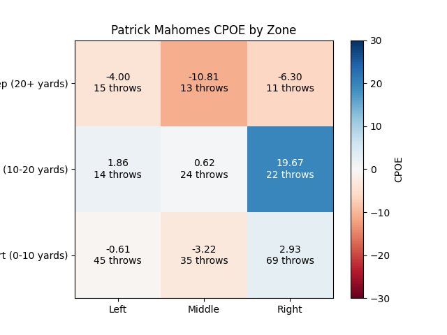
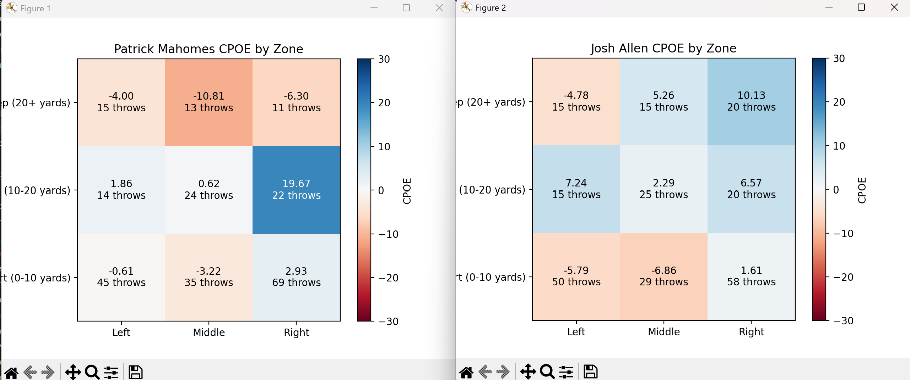

# NFL QB Heatmaps

A CLI tool that lets the user see how accurate any NFL QB is in the zones of the field.
## The Problem

When I was watching the NFL games today, I noticed that quarterbacks vary significantly to the naked eye on accuracy depending on what part of the field they are throwing to. To confirm this theory, I want to build a QB heatmap tool that lets the user select any QB and see how accurate he is in each zone of the field (short, intermediate, deep) (left, middle, right). I care about this because I want to be able to know QB tendencies in order to accurately judge how good a QB truly is overall.  

## How It Works
1. **Download:** The first time it is ran, the tool downloads this season's NFL play by play data from nflverse and saves it to data/data.csv.
2. **Process:** The tool removes running plays, sacks, spikes, two-point conversions, etc, and sorts each throw into zones by depth (short, intermediate, deep) and direction (left, middle, right). It excludes throws behind the line of scrimmage because CPOE is more useful for passes past it. The tool then calculates the average CPOE for each QB in each zone and saves it to data/qb_cpoe.csv.
3. **Cache:** Later runs reuse those same csv files, making it so only the first run needs to be connected to the internet.
4. **Filter to the selected QB**: The tool matches the name typed by the user to the correct QB. For example, if the user types Jayden Daniels, it matches him to his stats.
5. **Display:** The tool draws the heatmap using matplotlib. 


## MVP Scope

- Command-line input to pick the QB.
- Load this season’s play-by-play data and filter to the selected QB’s pass attempts.
- Sort each throw into the zones (deep middle, short left, etc…).
- Calculate average CPOE for each zone.
- Display the heatmap. 

## Tech Stack

- **Language:** Python
- **Libraries:** Pandas, matplotlib, nflreadpy, pyarrow
- **Data source:** nflverse play by play data
- **Data storage:** CSV files that are created automatically on the first run

## Setup

```bash
git clone https://github.com/brgilly16/NFL-QB-Heatmaps
cd NFL-QB-Heatmaps
pip install -r requirements.txt
python src/main.py Patrick Mahomes
```

## Usage 

Run from the project folder. Enter the QB's name as **First Last**.

### View one QB

```bash
python src/main.py Patrick Mahomes
```




### Compare two QBs

```bash
python src/main.py Patrick Mahomes --compare Josh Allen
```



## Roadmap

- [x] Command-line input to pick a QB
- [x] Load this season's play-by-play data
- [x] Sort throws into zones
- [x] Calculate average CPOE for each zone
- [x] Display the heatmap
- [x] Comparison of two QB’s
- [ ] Simple GUI in Java that allows selection of QB’s.
- [ ] Feature that allows the user to select which season they want.

## Author

Brandon Gilbert, https://github.com/brgilly16
