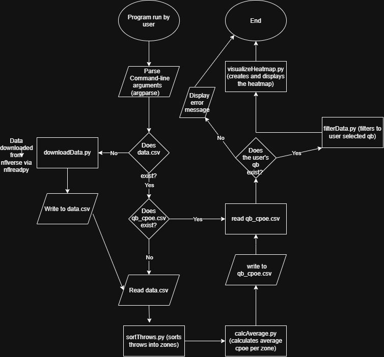

# NFL QB Heatmaps

A CLI tool that lets the user see how accurate any NFL QB is in the zones of the field.
## The Problem

When I was watching the NFL games today, I noticed that quarterbacks vary significantly to the naked eye on accuracy depending on what part of the field they are throwing to. To confirm this theory, I want to build a QB heatmap tool that lets the user select any QB and see how accurate he is in each zone of the field (short, middle, long) (left, middle, right). I care about this because I want to be able to know QB tendencies in order to accurately judge how good a QB truly is overall.  

## How It Works



## MVP Scope
- Command-line input to pick the QB.
- Load this season’s play-by-play data and filter to the selected QB’s pass attempts.
- Sort each throw into the zones (deep middle, short left, etc…).
- Calculate average CPOE for each zone.
- Display the heatmap. 

## Tech Stack

- **Language:** Python
- **Libraries:** Pandas, matplotlib, seaborn, numpy

## Setup


```bash
git clone https://github.com/brgilly16/NFL-QB-Heatmaps
cd NFL-QB-Heatmaps
pip install -r requirements.txt
python src/main.py "P.Mahomes"
```

## Roadmap


- [ ] Comparison of two QB’s
- [ ] Simple GUI in Java that allows selection of QB’s.
- [ ] Feature that allows the user to select which season they want.

## Author

Brandon Gilbert, https://github.com/brgilly16
